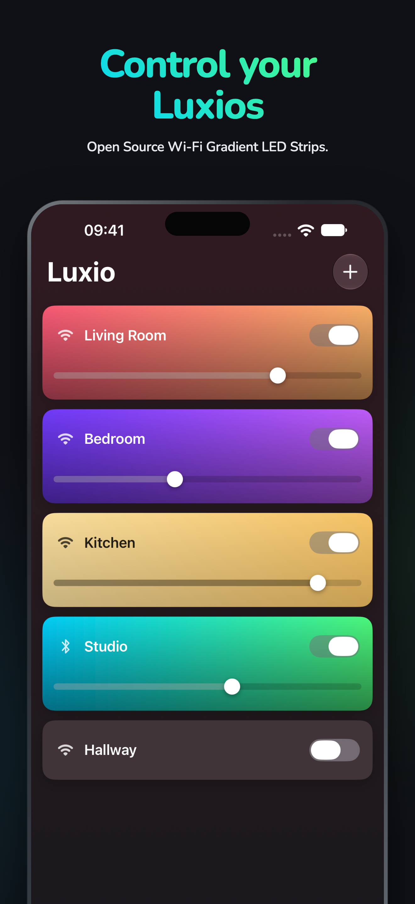
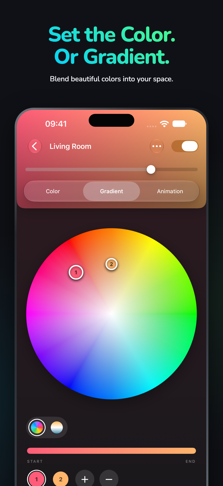
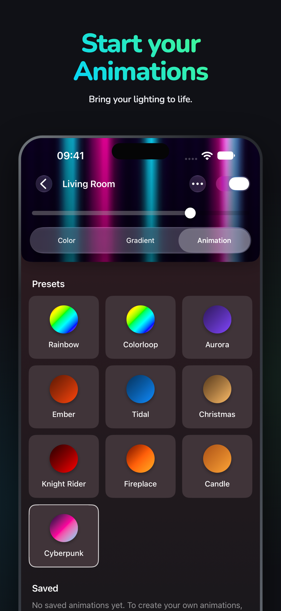
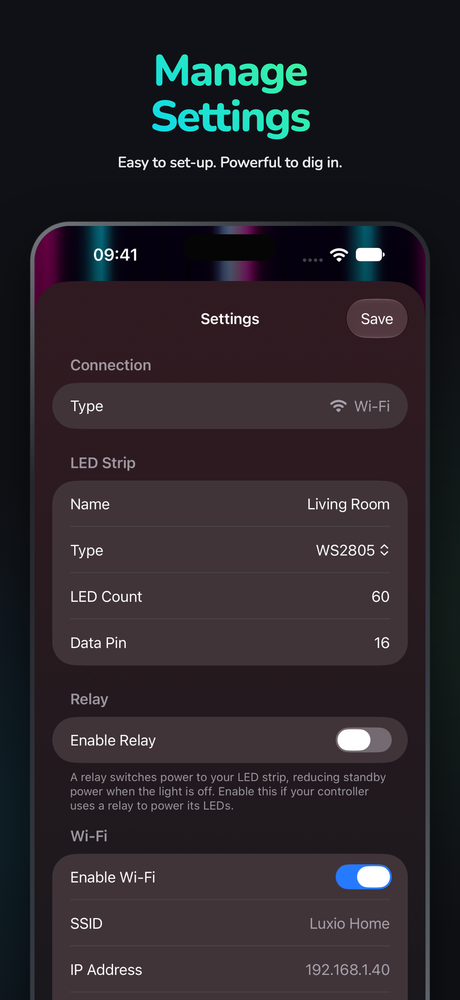
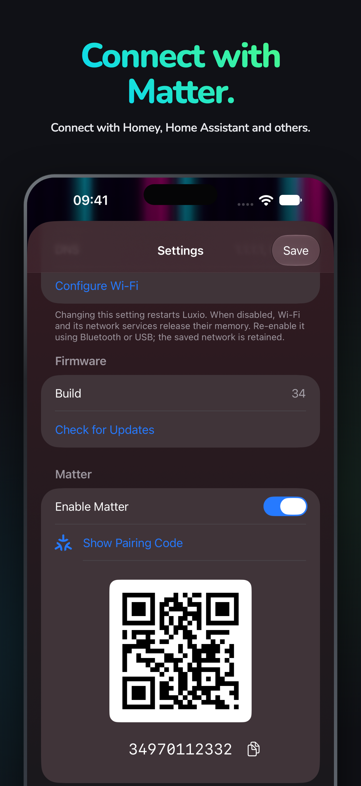

  
  <h1>Luxio for iOS</h1>
  
Color your space. Blend a gradient. Bring it to life.

  
<a href="https://luxio.lighting">Discover Luxio</a> · <a href="https://app.luxio.lighting">Web App &amp; Studio</a>

Control your Luxio LED strips from your phone. Pick the perfect color, create a gradient, or start an animation—all with a live preview of your lighting.

  
  
  
  
  

## Make it yours

- **Colors and whites.** Choose a preset or find your own shade with the color wheel. Adjust white light on strips that support it.
- **Your own gradients.** Add and drag color points to blend colors along your strip.
- **Animations that move.** Play built-in effects and adjust the controls each animation offers. Create your own with Luxio Studio.
- **Favorites, saved.** Keep colors, gradients, and animations on your Luxio device, ready to use again.
- **Everything in one place.** Control power and brightness, set up Wi-Fi, rename devices, and install firmware updates when you choose.
- **Connect with Matter.** Find your device’s pairing QR code in Settings to connect it to a compatible smart home system.

## Get started

1. Power on a controller running [Luxio firmware](https://github.com/luxio-lighting/luxio-firmware).
2. Open the app and allow Bluetooth and Local Network access when prompted. Nearby devices appear automatically; you can also add one by its network address.
3. Open a device and choose **Color**, **Gradient**, or **Animation**.

No hardware yet? Choose **Try the Simulator** from the empty home screen to explore colors, gradients, animations, and saved favorites.

Requires iOS 17 or later. Gradients need more than one addressable LED. White controls and Matter pairing appear when supported by your device.

## Help & contribute

Visit [luxio.lighting](https://luxio.lighting) for the build guide, or [report an issue](https://github.com/luxio-lighting/luxio-ios/issues) with the app. Luxio is open source—contributions are welcome. For build instructions and tests, see the [development notes](docs/development.md).
